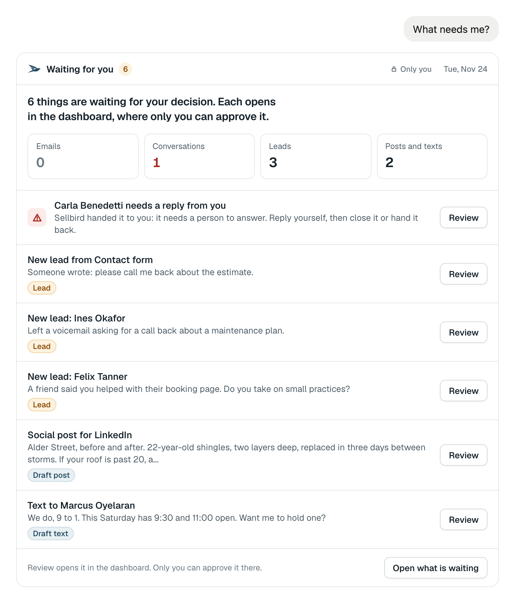
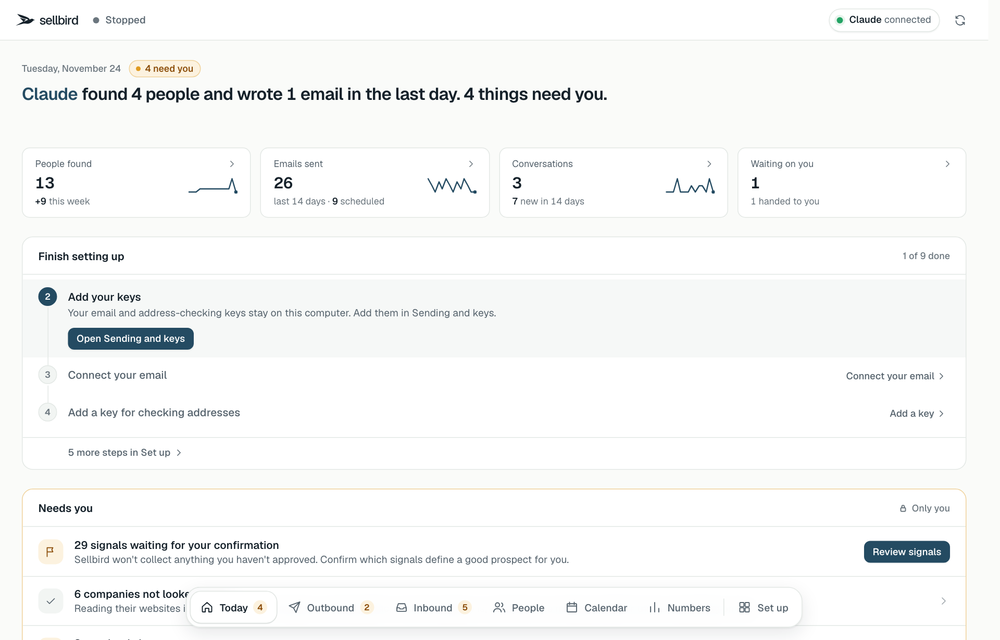
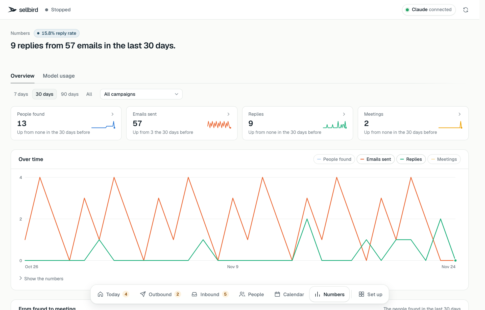

<p align="center">
  <a href="https://sellbird.ai">
    <picture>
      <source media="(prefers-color-scheme: dark)" srcset="docs/brand/sellbird-wordmark-white.svg">
      
    </picture>
  </a>
</p>

<p align="center"><strong>The open-source outreach platform that lives inside your agent, on your Claude or ChatGPT plan.</strong></p>

<p align="center">
Sellbird finds companies that need what you sell, finds the person who decides, checks their email address, writes each one a personal cold email, sends it and handles the replies.
It runs on your own machine, and by default nothing goes out until you approve it.
</p>

<p align="center">
  <a href="https://x.com/sellbirdagent"></a>
  <a href="https://github.com/ethanplusai/sellbird/stargazers"></a>
  <a href="https://github.com/ethanplusai/sellbird/actions/workflows/tests.yml"></a>
  <a href="LICENSE"></a>
  
  <a href="https://sellbird.ai/harvey/"></a>
</p>

<p align="center">
  <a href="https://trendshift.io/repositories/303676?utm_source=repository-badge&amp;utm_medium=badge&amp;utm_campaign=badge-repository-303676" target="_blank" rel="noopener noreferrer"></a>
</p>

> **[Harvey is now Sellbird.](https://sellbird.ai/harvey/)** Same project, same history, new name. Already running Harvey? Your setup carries over: see [Upgrading from Harvey](#upgrading-from-harvey).

**New releases, features and the roadmap go out first on X: [follow @sellbirdagent](https://x.com/sellbirdagent).**

Coming soon: a hosted version of Sellbird, at sellbird.ai.

## Inside your agent

New in 0.5: Sellbird lives where you already work, in Claude Code, Claude desktop and Codex. Run `sellbird connect` once (or press **Connect** in the dashboard), then ask your agent **"What needs me?"** or **"What did you do overnight?"**. It answers with a card in the chat: what Sellbird did, what waits for your OK, how each campaign is doing. One click opens the full app beside the chat, already signed in.

<picture>
  <source media="(prefers-color-scheme: dark)" srcset="docs/screenshots/agent-card-needs-you-dark.png">
  
</picture>

Your agent can read everything, draft, plan and explain. Approving, sending, buying and resuming are always your clicks, in the app. Your agent gets its own key with limited reach, never your dashboard token, and Set up, Your agent logs every call it makes and has a switch that cuts it off. More: [Sellbird inside your agent app](docs/agent-app.md).

## The app

Today, Outbound, Calendar and Numbers each open with one sentence on where things stand. A dock at the bottom holds six places: **Today** (what your agent did and what only you can decide), **Outbound** (drafts waiting for you, replies, campaigns, finding businesses, signals, social), **Inbound** (leads from your site's forms, texts, mentions), **People** (and companies), **Calendar** (week and month, with meetings and scheduled sends) and **Numbers** (charts over time and a found-to-meeting funnel), plus **Set up**. It fits a phone and the narrow side panel of an agent app the same way.

<picture>
  <source media="(prefers-color-scheme: dark)" srcset="docs/screenshots/today-dark.png">
  
</picture>

<picture>
  <source media="(prefers-color-scheme: dark)" srcset="docs/screenshots/numbers-dark.png">
  
</picture>

<sub>The demo data is invented: "Bookwell" selling online booking to roofers, dental practices and HVAC shops, on `.example` and `.test` domains.</sub>

## What it does

Sellbird is a pipeline you can run end to end, or stop at any step.

| | What happens | More |
|---|---|---|
| **Find companies** | Searches for businesses that match your customer: free on OpenStreetMap, or on a paid source you pick. Every paid search shows its cost before it runs. | [Discovery](docs/signals-and-pipeline.md#1-discover--who-exists) |
| **Learn why they'd buy** | Reads each company's own website for the buying signals you confirmed, like no online booking, ads running or a role they're hiring for. No model calls, no cost. | [Signals](docs/signals-and-pipeline.md) |
| **Find who decides** | Finds the owner or manager named on the company's own pages, two people per company at most. | [Enrich](docs/signals-and-pipeline.md#3-enrich--who-decides) |
| **Check the address** | Learns the company's email pattern and verifies one address. Every address is marked verified, risky, guess or invalid, and only deliverable ones are ever sent to. | [Verify](docs/signals-and-pipeline.md#4-verify--can-you-reach-them) |
| **Write and send** | Writes a short sequence for each person from what it found, then sends from your Gmail, Microsoft 365 or SMTP mailbox inside your daily limit and their office hours. | [Sending](docs/approval-and-sending.md) |
| **Handle replies** | Reads every reply, drafts an answer, sets auto-replies aside, honours opt-outs at once, and hands you anything it shouldn't answer alone. | [Dashboard](docs/dashboard.md) |

Only want the list? Stop after verifying and run `sellbird export` for a sequencer-ready CSV of everything it found.

```
$ sellbird run

============================================================
Sellbird is online.
============================================================
Checking pipeline state...
Decision: write_campaign (3 new prospects with no drafts)
  handler   → Elena Park, Harbor Dental Studio     interested, answer drafted
  handler   → Priya Nair, Highline Roofing         objection, answer drafted
  writer    → 2-email sequence: Phoenix HVAC hiring a dispatcher
  outbox    → 5 emails waiting for your approval
Cycle complete. Sleeping for 15 minutes.
```

## No model API bill

Sellbird thinks through the Claude Code CLI on your Claude Pro or Max plan, or through Codex on a ChatGPT plan. There's no API key and no per-token billing, and Sellbird throttles itself to leave room for your own work.

| | |
|---|---|
| Claude Pro or Max, or a ChatGPT plan with Codex | the subscription you already have |
| Finding businesses | **$0** on the default source, or about $0.37 per 1,000 on the cheapest paid one |
| Reading their websites | **$0**: three HTTP requests each, no model call |
| Writing and sending | your subscription and a mailbox (about $7 a month for Google Workspace) |
| Prospecting tools | **None.** No Apollo, ZoomInfo, Clearbit or Clay. |

How the loop, the budget and the isolation work: [How Sellbird works](docs/how-it-works.md).

## Quick start

You need:

- **Python 3.11 or newer.** macOS ships 3.9, so run `brew install python@3.13` first if `python3 --version` says so.
- **Claude Pro or Max** with the CLI signed in (`claude login`), or a **ChatGPT plan with the Codex CLI** ([Codex setup](docs/codex.md)).
- **A mailbox to send from**, ideally Google Workspace on a separate sending domain. [Microsoft 365](docs/microsoft365.md) and SMTP work too.
- **Warmup on that mailbox.** We recommend [TrulyInbox](https://trulyinbox.com/?via=sellbird): it warms a new mailbox before cold email and keeps it out of spam after, and Sellbird reads its inbox rate to tell you when you're ready.
- **An address checker.** Without one, found addresses are guesses and are never sent. We recommend [Reoon](https://www.reoon.com/email-verifier/) for its free tier (600 checks a month), and [ZeroBounce](https://www.zerobounce.net/members/signup) as well if you write to Microsoft 365 or Google Workspace domains.

Finding businesses and people is free: businesses come from OpenStreetMap, people from each company's own site. When that runs thin, we recommend [DataForSEO](https://app.dataforseo.com/register) for more businesses (about $0.37 per 1,000, $1 free to try) and [Hunter](https://hunter.io/users/sign_up) for the right person at each (25 searches a month free). `sellbird recommended` lists the one service we recommend for each job, and why.

### Let Claude set it up

```bash
git clone https://github.com/ethanplusai/sellbird.git
cd sellbird
claude
```

Then say **"set up Sellbird for me"**. The repo's `CLAUDE.md` turns Claude Code into the setup guide: it checks where you are, installs what's missing, asks what it needs and trains Sellbird on your product.

### Or do it yourself

```bash
# 1. Install. Use python3.13, not python3: on macOS bare python3 is 3.9.
python3.13 -m venv .venv && source .venv/bin/activate && pip install -e .

# 2. Add credentials. Every variable is documented inline.
cp .env.example .env && $EDITOR .env

# 3. Learn your product from your website (writes sellbird.local.yaml).
sellbird train https://your-company.com

# 4. Confirm what makes a good prospect.
sellbird signals --confirm free

# 5. Find businesses. The default source is free and needs no account.
sellbird discover

# 6. Open the dashboard and start the loop.
sellbird dashboard          # prints a private link to http://127.0.0.1:5555
sellbird run
```

On Linux you can also [run it with Docker](docs/docker.md).

### Connect your agent

```bash
sellbird connect
```

It finds Claude Code, Claude desktop and Codex on your machine, shows the line it will add to each, and adds them all on one yes. Then ask your agent "Open Sellbird" or "What needs me?":

- **Claude Code** and **Codex** (the CLI and the app): start a new session.
- **Claude desktop**: quit it completely and open it again. It can open the dashboard in its side panel and show cards in the chat.

Or click **Connect** in the dashboard, under Set up, Your agent: one row per agent, with Connect, Reconnect (when Sellbird has moved) or Remove. It works on macOS and Windows, including the Microsoft Store build of Claude desktop.

`sellbird connect claude-desktop` (or `claude`, `codex`) does just one. `sellbird connect --remove` takes Sellbird out again. Nothing goes into those configs but the command and Sellbird's folder: no key, no token.

ChatGPT and claude.ai in a browser connect from their own servers, so they can't reach Sellbird on your machine. On a ChatGPT plan, use Codex.

## Nothing sends without you

Every outgoing email waits in the Outbox for your approval until you turn on autopilot yourself. Before anything leaves, a pre-send check with no model involved rejects unfilled merge tags, banned phrases, overlong emails, extra links and undeliverable addresses. Autopilot still holds back any email that links to a domain that isn't yours or quotes Sellbird's own instructions. `sellbird sending pause` stops everything at once.

Details: [Approval and sending](docs/approval-and-sending.md) and [Legal and deliverability](docs/deliverability.md).

## Upgrading to 0.5

```bash
git pull
pip install -e .
sellbird connect        # once: adds Sellbird to Claude Code, Claude desktop and Codex
sellbird dashboard
```

Your config, data and dashboard sign-in carry over, and nothing needs editing. If you added Sellbird to an agent by hand before, `sellbird connect` shows the change and replaces that entry on your yes, keeping a copy of each settings file. The [changelog](CHANGELOG.md) has the full list, under "Upgrading from 0.3 and 0.4".

## Upgrading from Harvey

Harvey was renamed Sellbird in 0.4.0. Your configuration, data and dashboard sign-in carry over:

```bash
git pull
pip install -e .        # once, to get the new `sellbird` command
sellbird dashboard
```

- On first run Sellbird renames `harvey.local.yaml` to `sellbird.local.yaml` and `data/harvey.db` (and its log) to `data/sellbird.*`. It never overwrites a file that already exists under the new name, and waits if a Harvey process is still running from the folder. Stop that first.
- `HARVEY_*` environment variables still work when the `SELLBIRD_*` one isn't set; rename them when convenient.
- The `harvey` command and `python -m harvey` still work for now and say they moved. They will be removed in a later release.
- If you edited the tracked `harvey.yaml` directly, `git pull` stops with "your local changes would be overwritten". Run `git stash`, `git pull`, then `git stash pop`. Git carries your edits into `sellbird.yaml`. If it reports a conflict there, keep your lines, delete the conflict markers, and run `git stash drop`. Better still, put your settings in `sellbird.local.yaml`, which git never touches.
- Docker: the service is now `sellbird`. Run `docker compose down`, `git pull`, `docker compose build`, then `docker compose up -d`. `HARVEY_UID`/`HARVEY_GID` are still read.

Links to `github.com/ethanplusai/harvey` keep working: GitHub redirects them here.

## Where your files live

Your config, knowledge and data live in one home folder. Which one, first match wins:

1. `SELLBIRD_HOME`, if you set it (the Docker image sets it to `/app`).
2. A checkout: the checkout folder itself, as before.
3. Otherwise, for an installed package (`pip` or `pipx`), your user data folder:

| | Home folder |
|---|---|
| macOS | `~/Library/Application Support/sellbird` |
| Windows | `%APPDATA%\sellbird` |
| Linux | `~/.local/share/sellbird` (or `$XDG_DATA_HOME/sellbird`) |

Inside it are `sellbird.yaml` (and `sellbird.local.yaml` once you train), `.env`,
`prompts/` and `skills/`, all yours to edit. An installed package copies the defaults in on
first run and never overwrites them, so your edits survive upgrades. `data/` holds the
database, the logs and the dashboard token.

## Documentation

| Guide | What's in it |
|---|---|
| [How Sellbird works](docs/how-it-works.md) | The heartbeat loop, the subscription budget, project structure and the ideas behind it |
| [Signals and the prospecting pipeline](docs/signals-and-pipeline.md) | The 29 signals, cohorts, and the discover, profile, enrich and verify stages |
| [Skills and sub-agents](docs/skills-and-agents.md) | The editable sales playbooks and which agent uses which |
| [Approval and sending](docs/approval-and-sending.md) | The Outbox, autopilot, office hours and email signatures |
| [The dashboard and the data](docs/dashboard.md) | Every screen, how sign-in works, and how the data is stored |
| [Configuration and commands](docs/configuration.md) | `.env`, `sellbird.yaml` and every command |
| [Extensions](docs/extensions.md) | Adding routes, heartbeat steps and commands from a separate package |
| [Using a ChatGPT plan (Codex)](docs/codex.md) | Running on Codex instead of Claude |
| [Sellbird inside your agent app](docs/agent-app.md) | Connecting your agent, cards in the chat, and the dashboard in its side panel |
| [Inbound leads](docs/inbound-leads.md) · [Texting](docs/texting.md) · [Mentions](docs/mentions.md) · [Social](docs/social.md) · [Events](docs/events.md) | Leads from your forms, consent-first texts, brand mentions, social playbooks and webhooks |
| [Legal and deliverability](docs/deliverability.md) | The rules you're sending under, and warmup |
| [Microsoft 365](docs/microsoft365.md) · [Precleared](docs/precleared.md) | Provider setup guides |
| [Docker](docs/docker.md) · [Troubleshooting](docs/troubleshooting.md) · [Roadmap](docs/roadmap.md) | Running, fixing and what's next |

## Contributing

Pull requests are welcome. Read [CONTRIBUTING.md](CONTRIBUTING.md) first: it covers keeping real contact data out of the repo, test email, signing off your commits, and the one-time [Contributor License Agreement](CLA.md). Found a security problem? Follow [SECURITY.md](SECURITY.md) instead of opening an issue.

See [CHANGELOG.md](CHANGELOG.md) for what changed in each release, and [follow @sellbirdagent on X](https://x.com/sellbirdagent) to hear about new ones first.

## License

Sellbird is licensed under the [GNU Affero General Public License v3.0](LICENSE). Harvey releases up to 0.3.x were released under MIT, and that code keeps its MIT notice in [NOTICE](NOTICE).

TrulyInbox links in this project are affiliate links: the maintainer may earn a commission, at no extra cost to you.
