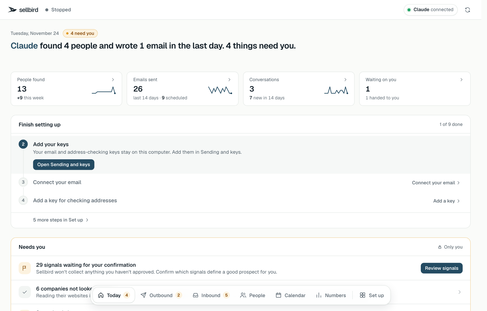

# The dashboard and the data

## The dashboard

```bash
sellbird dashboard     # prints the link to open, e.g. http://127.0.0.1:5555/#token=…
```

**Opening it.** The dashboard can change your mail settings, approve the outbox and start Sellbird, so it is locked to you, not just to your machine. On first start it creates a random token in `data/dashboard-token` (readable only by you) and prints a link carrying it after the `#`. Open that link: the page keeps the token for that browser tab only and removes it from the address bar. A new tab, or a tab opened without the link, shows a locked screen; paste the token there, or run `sellbird dashboard --url` to print the link again. Every API request needs the token as an `Authorization: Bearer` header — scripts and `curl` included — and the token is never accepted from a cookie or a query string. Delete `data/dashboard-token` and restart the dashboard to replace it.

**It only listens on this machine.** `--host` accepts loopback addresses only (`127.0.0.1`, `::1`, `localhost`), and requests must name one of them in their `Host` header, which also stops a DNS name pointed at 127.0.0.1 from reaching it. Requests sent by other websites open in your browser are refused. To use it from another computer, tunnel instead of exposing it: `ssh -L 5555:127.0.0.1:5555 your-machine`, then open the printed link locally. The token protects against other users and other websites, not against programs already running as your own user account, which can read the token file just as they can read `.env` or the database.

**Windows:** the token file is protected by the permissions of the folder it lives in (your user profile normally restricts this to you); Sellbird doesn't apply POSIX file modes there.

Plain HTML, CSS and JavaScript served from `sellbird/web/`. No build step, no framework, no bundler — edit `app.css` and reload. Fonts are vendored, so it renders correctly with the network off.

<picture>
  <source media="(prefers-color-scheme: dark)" srcset="screenshots/today-dark.png">
  
</picture>

There is no sidebar and no top bar. A dock floats at the bottom with six places, and the page fills the width it is given. A count on a place means something is waiting there. The layout reads the size of its own frame, not the window, so it works the same in a browser, on a phone, and inside the 320 to 420 pixel panel an agent such as Codex can show beside its chat.

- **Today**: four headline figures with 14-day trends, then everything that needs a decision, what the pipeline is doing right now, recent activity, people by stage and collector runs. Setup shows here until it is finished, then disappears.
- **Inbox**: five views (**Leads**, **Texts** and **Mentions** are described below). **Replies** is every reply in the context of the emails that led to it; threads Sellbird handed to you come first, with **Hand back to Sellbird**, **Close** and **Reopen**. **Outbox** is the decisions desk: each email sits next to what Sellbird knew when it wrote it. `J`/`K` to move, `A` approve, `E` edit, `R` reject.
- **People**: everyone found, by stage, searchable, with CSV export. **Companies** is the second view, sorted by a 0-100 fit score, with each company's status (emailed, draft waiting, or why not contacted); open one for its details, or export the whole register.
- **Calendar**: the next seven days of the Outbox by day (waiting for you, approved and scheduled, sent), and the people who agreed to meet. Sellbird records that a meeting was agreed; the time lives on your own calendar.
- **Numbers**: people found, emails sent, replies and reply rate over 2, 6 or 12 weeks, by campaign and by inbox. **Model usage** is the second view: Claude or Codex quota gauges and per-agent token counts, with no dollar figures, because a subscription is not billed per token.
- **Set up**: one row each for **Your company**, **Campaigns**, **Signals** (the confirmation gate and the cohort builder), **Find businesses** (the provider menu with prices side by side, an estimate, then a run), **Inboxes**, **Sending and keys**, **Engine** (start, stop, log), **Activity** and **Help**. Each opens with a way back.

Under **Set up** there are also: **Email records** (MX, SPF, DKIM and DMARC on each sending domain, with what to change; read only), **Limits and rules** (the stop button, every sending limit, and anything that sends without you), **Opt-outs and bounces** (the never-email list, with the reason for each entry and a CSV export), **Texting and consent**, **Events and webhooks**, and **Your agent** (what your coding agent may do, a log of every call it made, and a switch that cuts it off at once; only you can switch it back on). A name on **People** opens that person's page: the deal (worth, next step, notes), every email, reply and text, their consent records, stage history and meetings.

**Leads**, under Inbox, lists the people who came to you (a form email Sellbird read, or a lead you or your agent added), what each one sent, and where its first answer stands. It has a short form for adding one by hand and shows how leads arrive. See [inbound leads](inbound-leads.md).

**Mentions**, under Inbox, lists where people wrote about you, a competitor or the thing you sell. Each one can become a lead, a reply you copy and post yourself, or a note. **Brand mentions**, under Set up, is what is watched and where Sellbird looks. See [brand mentions](mentions.md).

Addresses work as links: `#outbox`, `#signals`, `#calendar` and so on open that screen.

| Outbox | Conversations |
|---|---|
| <picture><source media="(prefers-color-scheme: dark)" srcset="screenshots/outbox-dark.png"></picture> | <picture><source media="(prefers-color-scheme: dark)" srcset="screenshots/conversations-dark.png"></picture> |

Colour is kept for meaning. The surface is neutral and a single accent, Pale Harbor, marks what you can act on and where you are. Status (waiting on you, done, failed, running) uses the same small set of tones on every screen. Figures are tabular, so columns line up and a changing number does not shift the layout. The logo is the real signature file, `sellbird/web/sellbird-signature.svg`, drawn as a mask so it takes the text colour.

Appearance has three states: `auto` follows your OS and is the default, or pick light or dark under Set up. Dark mode uses the same layout with a different set of colour tokens.

---

## How the data is stored

SQLite at `data/sellbird.db`. One idea drives the schema:

> **Every fact is a row, never a column.**

Not `companies.has_agency`. Not `companies.rank`. A row in `observations`:

```
observations(company_id, prospect_id, collector, signal_code,
             value_num, value_text, confidence, evidence_url, observed_at, run_id)
```

Four things fall out of that, none of which you get from columns:

1. **A new signal needs no migration.** A collector invents a code and it works.
2. **History is free.** The same signal observed quarterly *is* a time series — and "they dropped their agency last quarter" is a far better trigger than any static fact.
3. **Confidence and provenance travel with the fact** instead of being lost on overwrite. *"We think their agency is X, 0.9 confidence, here's the URL."*
4. **A cohort is a query.** Set intersection happens in SQL, not in application code over a capped fetch.

The vocabulary is governed: a database trigger rejects any `signal_code` not in the `signal_codes` table, so a typo fails loudly instead of quietly inventing a junk signal.

Other tables: `companies`, `prospects`, `campaigns`, `conversations`, `outbox`, `actions`, `runs`, `usage_events`, `email_patterns`, `settings`, `feedback`.
